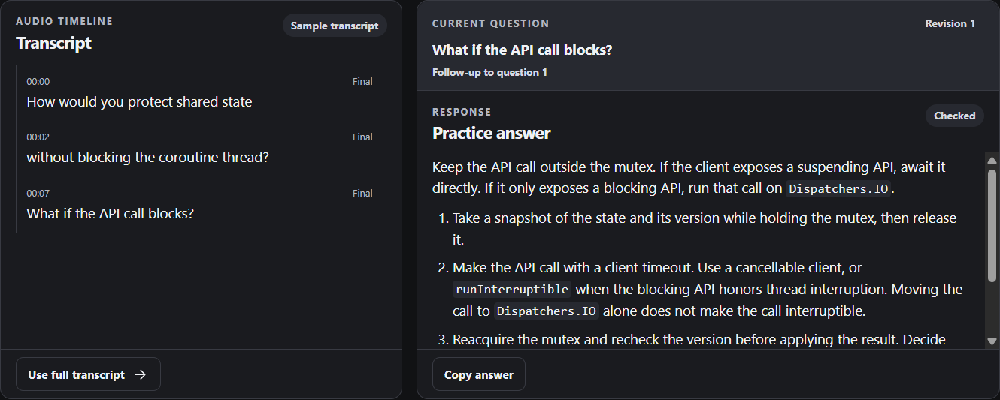

  <picture>
    <source media="(prefers-color-scheme: dark)" srcset="docs/brand/assets/openkeet-logo-on-dark.svg">
    
  </picture>

# OpenKeet

**Your personal AI interview assistant.**

**Interview smarter. Answer better.**

Interviews can be stressful. Preparing for them shouldn't be. OpenKeet helps you practice questions, understand what's being asked, and work through answers you can put in your own words.

[Get started on Windows](docs/getting-started.md) · [See it in action](#see-it-in-action) · [Documentation](docs/README.md) · [Contribute](CONTRIBUTING.md)

**Windows 11 x64 preview.** Build from source to try OpenKeet today. Prebuilt downloads will appear in [GitHub Releases](https://github.com/Jigsaw777/Personal-Interview-Assistant/releases) when packages are ready. [MIT source license](LICENSE)

## What you can practice

| If you want to… | Try this in OpenKeet |
| --- | --- |
| Explain a technical idea | Ask about a coding concept or a design trade-off. Practice explaining the answer aloud. |
| Tell a clearer story | Ask for feedback on a behavioral answer. Give the situation, your task, your action, and the result. |
| Follow a mock interviewer | Select their audio or your microphone. OpenKeet transcribes locally and flags likely questions. |
| Work through a follow-up | Request a suggestion for the detected question or ask your own. Save the session if you want to revisit it. |

The sample is a good place to start if you're preparing for your first interview. Engineers can work through trade-offs, career switchers can practice describing transferable skills, and experienced candidates can rehearse leadership stories. [Practice guide](docs/interview-preparation.md)

## From a question to a clearer answer

1. Open OpenKeet and select **Try a sample**. It runs offline with a prepared transcript and example answers.
2. To practice with your own questions, connect an answer model. You can type a question or set up local transcription for a mock interview.
3. Review what OpenKeet heard and request a suggestion. Check the reasoning and say the answer in your own words.
4. When the session ends, choose **Save to history** if you want to keep the transcript and checked answers.

## See it in action

This is the Windows app running its built-in rehearsal with synthetic interview text. [Screenshot gallery](docs/community/screenshots.md)

## Use AI your way

- **Start offline.** The bundled sample needs no account or model download. For your own audio, install a speech model to transcribe locally.
- **Run answers on your PC.** Connect a local model through Ollama. Download size, memory use, and speed depend on the model and computer.
- **Connect a service.** The preview implements a Claude Console API-key route with separate usage billing and an experimental **Sign in with ChatGPT** route for eligible plan usage. Account access and usage limits depend on the provider.

[Model setup, eligibility, and billing](docs/ai-providers.md)

## Your interview prep is personal

You choose one microphone or Windows playback device when you start listening. OpenKeet transcribes that audio on your PC and keeps the current transcript in the session. When you request an answer from a cloud provider, OpenKeet sends the question and relevant text context to that provider. Save a finished session only if you want a local history entry. You can export or delete it from **History**. [Data and privacy guide](docs/privacy.md)

For real interviews or assessments, follow the interviewer's rules. Get permission before capturing someone else's audio or using live AI help. [Live assistance guide](docs/live-assistance.md)

## Common questions

**Is it free? Do I need an AI subscription?** OpenKeet has no app subscription. The offline sample is included and local Ollama models need no AI service account. Connected services may charge for usage. The repository declares MIT for project source. The public distribution review is tracked in [release readiness](docs/release-readiness.md).

**Can I install it without programming?** The current preview requires a Windows source build or an installer built by a maintainer. After launch, the sample and regular setup use buttons and menus. Follow the [Windows setup guide](docs/getting-started.md).

**Do I need a powerful PC or internet access?** The sample runs offline. Building the app and downloading speech or answer models need internet access. Once downloaded, local transcription and local Ollama answers can work offline. Larger models can use more disk space and memory. [Model requirements](docs/ai-providers.md#local-answers-with-ollama)

**Can this help with a coding interview?** Use it to practice explaining code, choosing data structures, or describing system-design trade-offs. Review suggestions yourself. Your preparation and the interview determine the outcome.

**Does OpenKeet record interviews?** Listening processes audio in memory. The desktop app lets you explicitly save retained text and answers to a local library. [What gets saved](docs/privacy.md#what-stays-on-your-pc)

## Help shape OpenKeet

You don't have to write code to help. Share a confusing setup step, a question the app missed, or an accessibility issue. If OpenKeet helps you prepare, you can star the repo to find it again.

- [Ask a question or share an idea](https://github.com/Jigsaw777/Personal-Interview-Assistant/discussions)
- [Report a bug, request a feature, or flag a documentation gap](https://github.com/Jigsaw777/Personal-Interview-Assistant/issues/new/choose)
- [Find beginner-friendly issues](https://github.com/Jigsaw777/Personal-Interview-Assistant/issues?q=is%3Aissue+is%3Aopen+label%3A%22good+first+issue%22)
- [Contribute code, testing, or docs](CONTRIBUTING.md)
- [See what's next](docs/roadmap.md)
