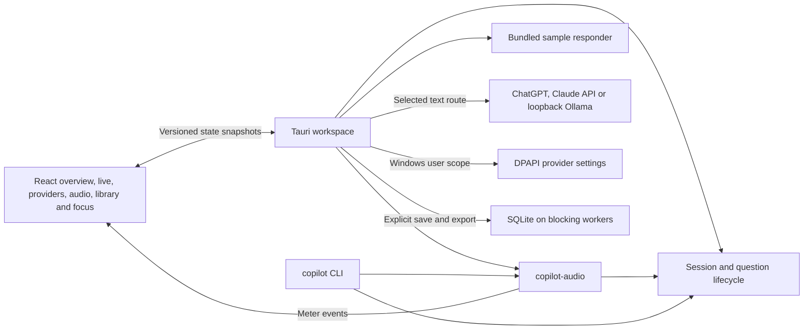
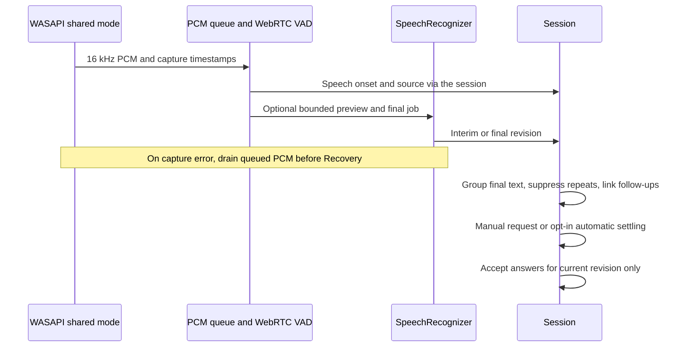

# Desktop runtime and data boundaries

The [baseline audit](../audit/CURRENT_ARCHITECTURE.md) maps the original crates. The updated build keeps the same Rust workspace and React bridge.

One selected Windows route runs per session. The audio pipeline owns separate capture, segment and decoder workers. `SpeechRecognizer` handles bounded PCM segments and allows the pipeline to test recovery independently of native inference. Full duplex, GPU, process-isolated ASR, and external transcription routing remain open.

The practice responder runs only in the sample session. Live automatic answers are disabled by default. Explicit requests preserve the detected question ID and revision. Short punctuated live questions can settle sooner than long or revised questions. Ongoing speech still prevents automatic commitment. Connected provider requests stream text through the same revision guard. A provider switch cancels active work. Request context contains the current question and an available linked parent question and answer. [Provider authorization audit](../audit/PROVIDER_AUTHORIZATION.md)

Windows owns a tray icon and registers the global Ctrl+Shift+I shortcut. The main workspace and Focus use native tool-window styles. Their style callback preserves those bits when the framework changes visibility or pinning.

Saved sessions use a versioned SQLite library in the Tauri app-local data directory. An explicit save stores retained final text and checked answers with a user-selected title. Endpoint identifiers and diagnostics are excluded. SQLite operations run off the main and audio threads. The store serializes save updates in a transaction and leaves existing notes intact. Search is a literal substring across the most recent matching titles and transcripts, limited to 50 rows. A native Save dialog chooses new export files. The library can delete saved data independently of the current workspace.
