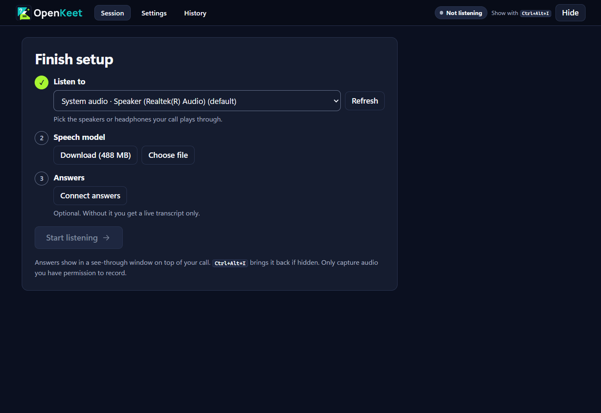
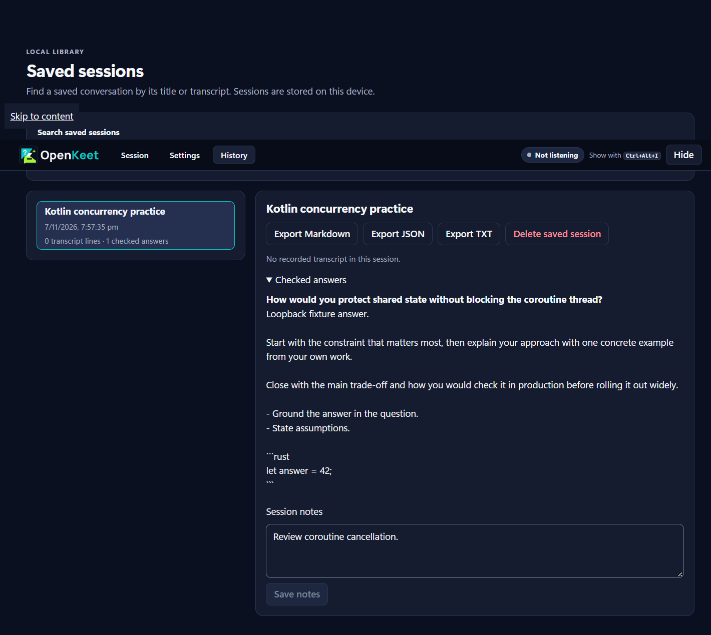

# OpenKeet screenshot gallery

These images come from the Windows WebView2 smoke test with synthetic questions.

## Get set up

Pick what to listen to, get a local speech model, and optionally connect answers.

## Revisit a saved session

After you stop and save a session, **History** lets you find it, add notes, export it, or delete it.

[Get started](../getting-started.md)
